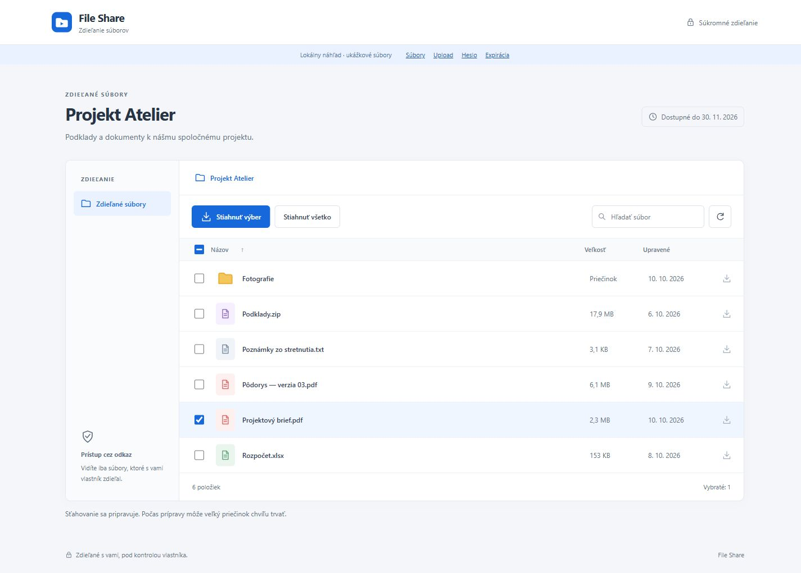
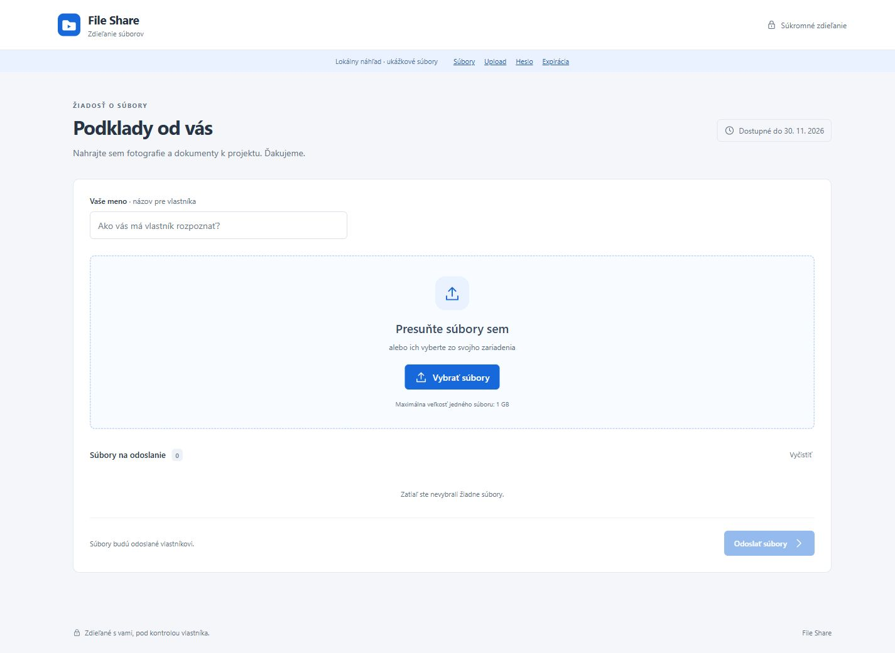

# Overenie implementácie

Lokálne overené 11. 10. 2026 na Windows, .NET SDK 10.0.401. Všetky testovacie dáta sú syntetické. Screenshoty neobsahujú skutočné tokeny ani súbory NAS.

## Automatické kontroly

- `dotnet test SynologyPublicShareProxy.slnx -c Release`: **31 úspešných testov**, bez zlyhania. Mock DSM overuje úzky protokol, scope share, odmietnutie podvrhnutých ciest/ID/redirectov, heslovú bránu, RSA/AES obálku, upload preflight a poradie multipart dát, stream limity, revokáciu, CSRF a rozpočet spojení.
- `python tests/http_smoke.py`: **29 úspešných kontrol** reálneho lokálneho HTTP servera. Overené hlavičky, cookie policy, Origin/Host/CSRF, default-deny, heslová relácia, expirácia, upload limit, attachment download, same-origin error frame a rate limiting.
- `node --check src/ShareProxy/wwwroot/app.js`: úspešná syntaktická kontrola.
- Release build prešiel s nulovým počtom warningov a chýb.

## Vizuálna a používateľská kontrola

Použitý lokálny demo režim v prehliadači. Desktop viewport 1440 × 960 a mobilný viewport 390 × 844. Mobilná stránka nemala horizontálny overflow.

- Výber položky, stav tlačidla, hľadanie v načítaných názvoch, otvorenie podpriečinka a návrat cez breadcrumb.
- Nesprávne heslo zobrazí chybu a vráti focus do poľa; správne demo heslo otvorí súbory.
- Výber syntetického súboru, validácia mena, upload a potvrdenie dokončenia. Lokálny demo upload dáta zahadzuje.
- Expiračný stav a tlačidlo opakovania.
- Upload stránka nemá pôvodný informačný/propagačný bočný blok. Ostal formulár, výber súborov, fronta a priebeh.
- Natívny download formulár po oprave hlavičiek nevykazuje blokovanie framingu ani chybu Origin. HTTP test potvrdzuje attachment odpoveď; automatizovaný download event in-app prehliadača neposkytol cestu k uloženému súboru, takže uloženie cez jeho download manager nie je týmto QA potvrdené.

`Referrer-Policy: strict-origin` posiela najviac origin, nikdy cestu so share tokenom, a zachováva Origin natívneho POST formulára. Iba download endpoint povoľuje same-origin rámec na zobrazenie JSON chyby. Ostatné stránky zakazujú framing.

[Mobilný download](screenshots/mobile-download.png) · [Mobilný upload](screenshots/mobile-upload.png) · [Expiračný stav](screenshots/expired.png)

## Zostáva overiť na NAS

Lokálne nebol dostupný Docker daemon, preto image/Compose runtime nebol na tomto stroji spustený. Docker build je v CI. Žiadny test sa nepripojil k fyzickému DSM.

HAR potvrdzuje požiadavky a úspešné odpovede, ale neobsahuje všetky cookie hlavičky. Najmä pokračovanie chránenej relácie cez `CookieContainer`, natívny single-file download, veľký ZIP, konflikty `overwrite=false`, prerušené uploady a správanie Synology reverse proxy treba overiť podľa [DSM checklistu](DSM-VALIDATION.md). Dotykový drag-and-drop a všetky kombinácie čítačiek obrazovky nie sú manuálne potvrdené.
